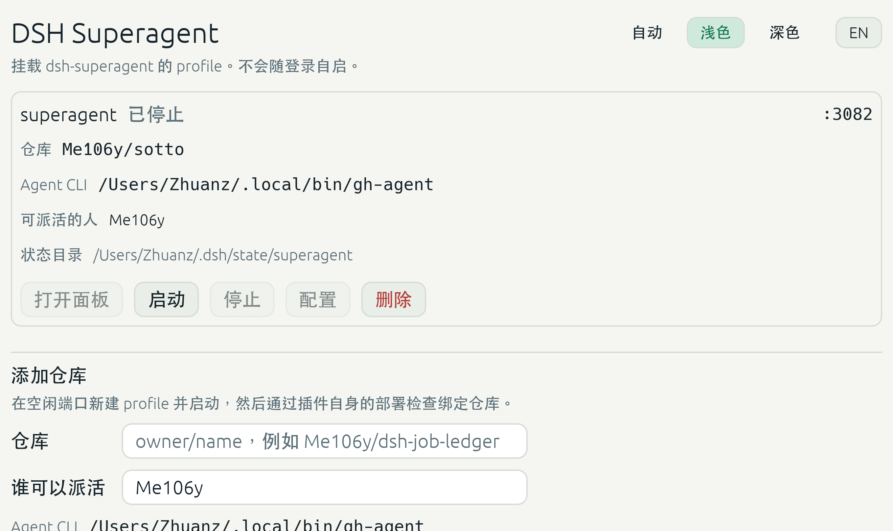
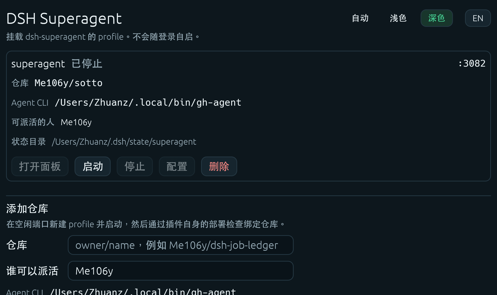
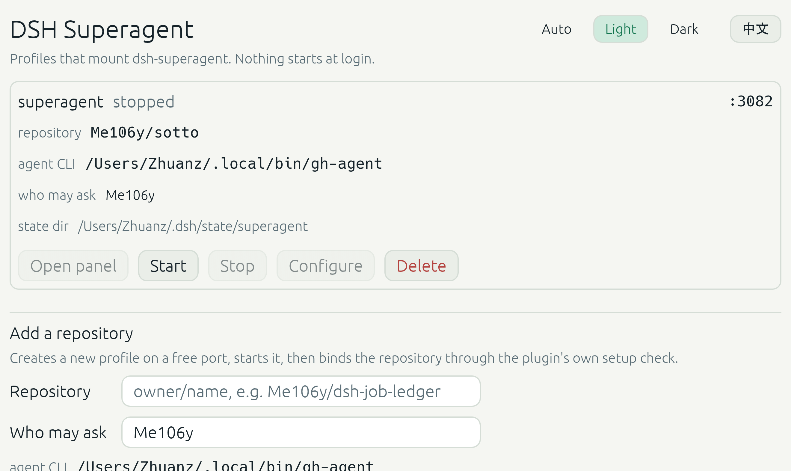

# DSH Superagent 启动器

给 [DeepSeek Harness](https://github.com/deepseek-ai) 上的 **dsh-superagent** 插件配的一个小窗口：
列出所有挂载了该插件的 DSH profile，一键**启动 / 打开面板 / 停止 / 删除**，也能直接新建
「仓库 → profile」的绑定。Rust + [egui](https://github.com/emilk/egui)，Linux 与 macOS。



| 浅色 | 深色 |
| --- | --- |
|  |  |

界面支持中文 / English 两套文案，跟随系统语言，也可以随时切换：



## 为什么需要它

dsh-superagent 的每个实例都跑在**独立的 DSH profile** 里：占一个端口、有一份
`cordis.patch.yml`、状态存在 `<stateDir>/orchestrator.sqlite`。平时要用它，得记住

- profile 叫什么、端口是多少；
- 它绑的是哪个 GitHub 仓库、用哪个 `gh` 身份干活、允许谁派活；
- 怎么启动、怎么打开带登录 token 的面板、怎么干净地停掉。

这些信息分散在配置文件、SQLite 和进程里。这个窗口把它们收进一个列表，并把
「新建一个仓库实例」变成一次表单提交。

## 能做什么

- **列出实例**：扫描 `$DSH_HOME/profiles/*/package.json`，只显示挂载了
  `dsh-superagent` 的 profile。
- **启动 / 停止**：启动时拉起 `node <runtime>/…/bin.js --profile <p> --no-open`，日志落在
  用户日志目录，token 从日志里读；停止用 `SIGTERM`，按命令行（`--profile <p>`）找进程并
  确认它确实是 DSH 进程，绝不错杀。
- **删除**：卡片上的「删除」→ 就地确认。先停掉实例并**等进程真正退出**，再删 profile
  目录和日志。状态目录（工单库、每单 checkout）默认保留，勾选「同时删除状态目录」才删，
  而且只删 `<dsh home>/state` 下的普通目录——符号链接和指到别处的 stateDir 一律保留并
  报出路径。进程 15 秒内没退出就一个文件都不动。
- **打开面板**：自动带上日志里最新一次登录 token，`xdg-open` / `open` 打开
  `http://127.0.0.1:<port>/?token=…`。
- **配置「谁可以派活」**：直接调插件的管理 API 写 policy，支持多个 GitHub 登录名
  （逗号或空格分隔），保存后会触发插件自己的重载。
- **添加仓库**：复制现有 profile → 选一个空闲端口 → 改端口和状态目录 → 启动 →
  调 `PUT /orchestrator/api/settings/source:github` 绑定仓库 → 写入每工单的 checkout
  命令。绑定走插件 API 而不是改文件，是为了让插件的**部署检查**（仓库可读、agent
  账号可 push）真的跑一遍。
- **Agent CLI 自动探测**：不需要用户填。依次尝试 `DSH_SUPERAGENT_AGENT_CLI` →
  已有 profile 的配置 → `~/.local/bin/gh-agent` → `~/.local/bin/gh-*`。
- **从桌面启动也能跑**：桌面启动不继承 shell 的 `PATH`（macOS 给的是
  `/usr/bin:/bin:/usr/sbin:/sbin`），而 agent CLI 是调用 `gh` 的包装脚本。启动器给拉起的
  profile 补上 Homebrew、`/usr/local/bin`、`~/.local/bin` 等目录，否则插件的部署检查会报
  `gh: not found`。
- **主题与语言**：浅色 / 深色 / 跟随系统；中文 / English（跟随系统语言）。

## 它从哪里读信息

| 事实 | 来源 |
| --- | --- |
| 哪些 profile 要管 | `<dsh home>/profiles/*/package.json` 里含 `dsh-superagent` |
| 端口 | `<profile>/cordis.patch.yml` 的 `- id: webserver` → `port` |
| 状态目录 | 同一文件 `- id: dsh-superagent` → `stateDir` |
| 仓库与 agent CLI | `<stateDir>/orchestrator.sqlite` 中 `block = "source:github"` 的最新一份设置 |
| 谁可以派活 | 同一个库中 `block = "policy"` 的 `allowed` 列表 |
| 是否在运行 | 对 `127.0.0.1:<port>` 做一次 TCP 连接 |

SQLite 是**链接**进二进制的（`rusqlite`，bundled），不依赖系统的 `sqlite3` 命令；
插件用 WAL 模式，所以后端用普通连接 + busy timeout 读取，进程退出后也能读。

## 安装

### 依赖

- Linux 或 macOS 桌面（X11 / Wayland 均可）
- 一份 DSH 安装：
  - macOS：`~/Library/Application Support/DeepSeekHarness/runtime`
  - Linux：全局 `@deepseek-ai/dsh` 包所在的 Node 安装（`~/local/node-*/lib/node_modules`、
    `~/.nvm/versions/node/*/lib/node_modules`、`/usr/local/lib/node_modules`、
    `/usr/lib/node_modules`），也可以用 `DSH_INSTALL_DIR` 指定
- `node`、`curl`
- 中文界面需要系统中有 CJK 字体（通过 `fc-match` 找，或用 `DSH_SUPERAGENT_FONT=path[:index]`
  指定；找不到时界面自动保持英文）

### 构建

```sh
cargo build --release          # 需要 Rust 1.85+（edition 2024）
```

### 装到桌面（Linux）

```sh
./packaging/install.sh
```

脚本会：

1. 把二进制装到 `~/.local/lib/dsh-superagent-launcher/`；
2. 在 `~/.local/bin/dsh-superagent-launcher` 写一个包装脚本（桌面启动不继承 shell 的
   `PATH`，这里补上 Node 安装目录）；
3. 安装图标和 `.desktop`（`~/.local/share/applications/`），刷新桌面数据库。

之后在应用列表里搜「DSH Superagent」即可打开，也可以固定到 GNOME dock：

```sh
gsettings set org.gnome.shell favorite-apps \
  "$(gsettings get org.gnome.shell favorite-apps | sed "s/]$/, 'dsh-superagent-launcher.desktop']/")"
```

### macOS

```sh
cargo build --release
./target/release/dsh-superagent-launcher
./scripts/install-app.sh        # 更新 ~/Applications/DSH Superagent.app
```

日志写到 `~/Library/Logs`，用 `open` 打开面板。`.app` 里带的是**自己的一份**二进制，
`cargo build` 不会更新它；`scripts/install-app.sh` 会重新构建、替换并用 ad-hoc 签名重签
bundle（替换可执行文件会让原签名失效，不重签 macOS 拒绝启动）。

## 用法

### 主界面

每个 profile 一张卡片：名称、运行状态、端口、仓库、agent CLI、可派活的人、状态目录，
下面是 `打开面板 / 启动 / 停止 / 配置 / 删除`。右上角切换主题和语言。

### 添加仓库

填两件事：

- **仓库**：`owner/name`，例如 `Me106y/dsh-job-ledger`；
- **谁可以派活**：一个或多个 GitHub 登录名，逗号分隔。

Agent CLI 不用填——它由部署阶段自动确定并显示在表单下方。点击「添加并启动」后，
新 profile 会出现在列表里，端口自动挑一个空闲的（默认从 3082 起）。

创建之前会先用 agent 账号的 `gh` 确认它对该仓库有 **push 权限**：没有权限就直接提示并
停止，避免留下一个空转的 profile。已经创建但没绑定仓库的实例，卡片上会出现
「绑定仓库」，补齐权限后再绑一次即可。没绑定成功的实例会显示「未绑定仓库」并带琥珀色
边框，不会被当成正常实例；失败信息会一直留在窗口底部，直到你关掉它。

### 命令行

窗口之外还提供几个无界面入口，方便脚本和排查：

```sh
dsh-superagent-launcher --list                     # 同界面内容的制表符视图
dsh-superagent-launcher --diagnose                 # 解析后的主题/语言、字体、agent CLI
dsh-superagent-launcher --add owner/name [--allow login,login] [--cli path]
dsh-superagent-launcher --accounts <port> <login,login>
dsh-superagent-launcher --remove <profile> [--purge]
dsh-superagent-launcher --screenshot out.png [--theme light|dark|system] [--lang zh|en]
```

## 平台说明

差异集中在 `src/platform.rs`：运行时目录、日志目录、`open` / `xdg-open` 的选择。
其余逻辑（profile / 端口 / SQLite / 设置 API）两平台共用。

## 安全

启动器本身不执行 agent 的命令，但它启动的 dsh-superagent 工作进程以**你的 OS 用户**
身份、`danger-full-access` 运行，能读写你的 home 目录。建议给 agent 单独一个系统账号，
只放它需要的凭据。

## 开发

```sh
cargo test        # 主题对比度、双语文案、字体覆盖等
cargo fmt
```

代码结构：

| 文件 | 负责 |
| --- | --- |
| `src/main.rs` | 发现实例、启动/停止/删除、设置 API、界面 |
| `src/platform.rs` | DSH 安装位置、日志目录、子进程 PATH、SQLite 读取、打开 URL |
| `src/theme.rs` | 浅色/深色两套配色与 egui 样式 |
| `src/i18n.rs` | 中英文案与模板替换 |
| `src/settings.rs` | 主题 / 语言的持久化 |
| `src/fonts.rs` | 从系统借一个 CJK 字体 |
| `packaging/` | 图标、桌面入口、Linux 安装脚本 |
| `scripts/install-app.sh` | 更新 macOS `.app` 里的二进制并重签 |

## 许可证

暂未授权，使用前请先询问。

## English

A small desktop launcher for the **dsh-superagent** plugin on DeepSeek Harness: it lists
every profile that mounts the plugin, starts / opens / stops / deletes it, and binds a new
repository on a fresh profile and port. Rust + egui, Linux and macOS, light and dark themes,
English and Chinese UI. See the screenshots above and the sections on installation and the
command line; `./packaging/install.sh` installs it into the application menu on Linux, and
`./scripts/install-app.sh` refreshes the macOS `.app` bundle.
